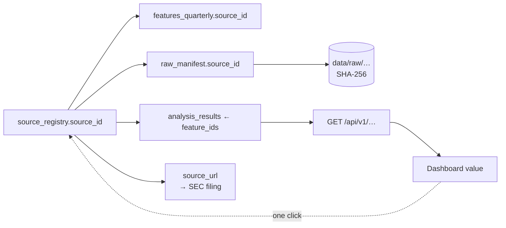

# AICOR — Data Dictionary & Provenance Contract

**Status:** Proposed · **Date:** 2026-10-13
**Authority:** implements SRS §5.2 (PRV-01) and §6.2. Where the SRS schema is silent, the addition is marked **[+]**. The SRS's own field list is preserved verbatim — the SRS is the contract, this document is its executable form.

---

## 1. The provenance spine

SRS §9.3 defines Done as a reviewer walking **Dashboard → Analysis Result → Feature → Calculation → Raw Data → Source ID → Source URL → SEC/official disclosure**, then reproducing the result. This document exists so each arrow above is a real foreign key rather than a convention.

## 2. Enumerations

| Enum | Values | Source |
|---|---|---|
| `source_tier` | `S`, `A`, `B`, `R` | SRS §3.1 |
| `confidence` | `HIGH`, `MEDIUM`, `LOW` | SRC-06 |
| `value_class` | `reported`, `derived`, `proxy` | SRS §1.4 |
| `status` | `ok`, `unavailable`, `not_applicable`, `suppressed`, `error` | SRC-05 **[+]** |
| `verification_status` | `unverified`, `verified`, `stale`, `superseded` | SRC-03 |
| `primary_or_secondary` | `primary`, `secondary` | SRC-03 |
| `period_basis` | `3M`, `6M`, `9M`, `FY`, `instant` | **[+]** — required by DQ-03 |
| `analysis_type` | `lag`, `io`, `efficiency`, `event`, `regime`, `sensitivity`, `robustness`, `risk`, `scenario` | **[+]** |
| `event_type` | `AI Model Launch`, `AI Product Launch`, `AI Partnership`, `AI Infrastructure Announcement`, `Earnings Release`, `AI Acquisition`, `Major AI Investment`, `Regulatory Event` | EVT-01 |

> `R` (Tier R, methodology references such as the CMU/SEI pages) is **excluded** from `source_registry` for financial data, per SRS §3.1. Documented here so its absence is deliberate and testable, not an oversight.

## 3. Tables

### 3.1 `companies`

| Column | Type | Notes |
|---|---|---|
| `company_id` | PK | `MSFT` \| `GOOGL` |
| `company_name` | text | |
| `ticker` | text | SRS §1.3.1 |
| `exchange` | text | `NASDAQ` |
| `cik` | bigint | **[+]** required to call SEC APIs |
| `fiscal_year_end` | text | `06-30` \| `12-31` |
| `business_description` | text | |

### 3.2 `filing` **[+ new — not in SRS §6.2]**

Required by invariant I-4: every XBRL fact must be attributable to a real filing.

| Column | Type | Notes |
|---|---|---|
| `accession_number` | PK | e.g. `0001193125-26-191507` |
| `company_id` | FK | |
| `form` | text | `10-Q` \| `10-K` |
| `period_end` | date | |
| `filing_date` | date | |
| `primary_document` | text | e.g. `msft-20260331.htm` |
| `source_url` | text | constructed from accession + document |
| `retrieved_at` | timestamptz | |

**Justification:** the SRS lists canonical URLs but not the filing *index*. Using the SEC `submissions` API as the source of truth (rather than hard-coded accessions) prevents the hard-coded list from rotting. Verified source of the two SRS accessions.

### 3.3 `source_registry` (SRC-03 verbatim)

| Column | Type | Notes |
|---|---|---|
| `source_id` | PK | |
| `company` | FK → `companies` | |
| `metric` | text | logical metric name, e.g. `revenue` |
| `source_type` | text | `SEC_10Q`, `SEC_10K`, `SEC_XBRL`, `IR_RELEASE`, `YAHOO_CSV` **[+]** |
| `source_tier` | enum | not null |
| `source_url` | text | |
| `reporting_period` | date | |
| `filing_date` | date | |
| `access_date` | timestamptz | B-01 resolution |
| `primary_or_secondary` | enum | |
| `verification_status` | enum | `verified` requires a successful manual/automated open |
| `xbrl_tag` | text | **[+]** which tag actually reported this fact — the OD-08 guard |
| `period_basis` | enum | **[+]** DQ-03 |

### 3.4 `raw_manifest` **[+ new]**

| Column | Type | Notes |
|---|---|---|
| `raw_id` | PK | content address |
| `sha256` | unique | |
| `source_id` | FK | |
| `retrieved_at` | timestamptz | |
| `byte_size` | bigint | |
| `storage_path` | text | |

This is what makes NFR-01 real: a re-run reads the manifest, not the network.

### 3.5 `financial_quarterly`

| Column | Type | Notes |
|---|---|---|
| `company_id` | FK | |
| `period_end_date` | **PK part 1** | join key — DAT-01 / I-5 |
| `fiscal_period` | text | e.g. `FY26Q3` — display only |
| `calendar_quarter` | text | **[+]** `2026Q1` derived from `period_end_date` |
| `revenue` | numeric | |
| `gross_profit` | numeric | |
| `operating_income` | numeric | |
| `net_income` | numeric | |
| `rd_expense` | numeric | renamed from `rd` per SRS note |
| `cfo` | numeric | |
| `capex` | numeric | **sign-normalised positive** (DQ-02) |
| `capex_definition` | text | **[+]** stored verbatim; finance leases excluded (OD-09) |
| `fcf` | numeric | `CFO − CapEx` |
| `assets` / `liabilities` / `equity` | numeric | DQ-04 |
| `shares` | numeric | |
| `eps` | numeric | |
| `source_id` | FK | |
| `status` / `reason` | enum / text | **[+]** SRC-05 |

**Key:** `(company_id, period_end_date)` — **not** the fiscal label. Verified consequence: MSFT `FY26Q3` and GOOGL `2026Q1` both ending 2026-03-31 correctly occupy one calendar quarter (DAT-01 / `DAT_T01`).

### 3.6 `segments_quarterly`

`company_id`, `period_end_date`, `fiscal_period`, `segment`, `revenue`, `operating_income`, `growth`, `source_id`, `status`, `reason`.
**Note:** FR-06/FR-07 prefer **segment XBRL (Tier S)** over IR scraping — machine-readable, and strengthens DQ-05 (OD-14).

### 3.7 `market_daily` (MKT-01)

`company_id`, `date`, `open`, `high`, `low`, `close`, **`adjusted_close`**, `volume`, `source_id`.

> **`adjusted_close` is mandatory**, not optional. SRC §3.1 lists it as a required field; SRS §3.6 gives "has `adjusted_close`" as the *reason* Yahoo was chosen. A series lacking it would void OUT-03 and EVT-03. Verified: `adjclose` present in all 1,512 bars retrieved for MSFT, GOOGL and `^GSPC`.

`^GSPC` stored as a pseudo-company row (MKT-02). Note recorded in `source_registry`: `^GSPC` is a price index, so its `adjusted_close = close` — an accepted limitation per SRS §3.6.

### 3.8 `ai_metrics`

Per SRS §6.2. **In practice this table holds no AI-specific metric** — AI-01 and AI-04 removed them. It is retained because it carries the *proxy* declarations (`reported_or_derived='proxy'`, `confidence='LOW'` for R&D) that FR-02 / AI-02 require. Retaining it prevents a future contributor from re-adding a fabricated `copilot_metric` without an explicit schema decision.

### 3.9 `ai_events` (EVT-01/02)

`event_id`, `company_id`, `event_date`, `event_type`, `description`, `source_id` **[+]**, `tier`, `cluster_id` **[+]**, `window_start`, `window_end`, `car`, `ar_total`.

**`cluster_id`** implements the OD-11 overlap policy: where `[-10,+10]` windows intersect, events share a `cluster_id` and are counted **once** in aggregate statistics while each retains its own CAR. `^GSPC` benchmark id + version stored per event (EVT-03).

### 3.10 `features_quarterly` (PRV-01 verbatim + required additions)

`feature_id` (PK), `company_id`, `period_end_date`, `feature`, `value`, `unit`, `definition`, `calculation_method`, `reported_or_derived`, `proxy`, `confidence`, `source_id`, **`status`** **[+]**, **`reason`** **[+]**, **`config_version`** **[+]**, **`input_feature_ids`** **[+]**.

> `input_feature_ids` is the addition that makes PRV-01's chain walkable: without it, a derived feature has no machine-readable link to its inputs and §9.3's "Feature → Calculation → Raw Data" step is manual reconstruction.

`source_url` and `source_tier` are reached via `source_id` (SRS §6.2 note) — not denormalised, to prevent drift.

### 3.11 `analysis_results`

`analysis_id` (PK), `company_id`, `period_end_date`, `analysis_type`, `metric`, `value`, `lag`, **`method`**, `confidence`, **`config_version`** **[+]**, **`status`**/**`reason`** **[+]**, **`n_observations`** **[+]**, **`ci_low`/`ci_high`** **[+]**, **`feature_ids`** **[+]**, `result_class`.

> `method`, `n_observations` and the CI columns implement IO-02 and OD-05: the estimator, the honest sample size (**n≈13**, not 21), and the uncertainty interval travel with every result. `result_class ∈ {observed, derived, association, interpretation, scenario}` enforces DEC-03 at the schema level.

### 3.12 `scenario_results`

`scenario_id`, `company_id`, `period_end_date`, `scenario_code`, `assumption` (JSON), `financial_effect`, `efficiency_effect`, `risk_effect`, `config_version`, `status`, `reason`.

> Per OD-12, effects are **arithmetic-only** quantities directly implied by the stated shock. Anything requiring an invented elasticity is emitted NULL with a reason. `assumption` is JSON so every scenario is self-documenting (SCN-01…03 label values ASSUMPTIONS, not guidance).

### 3.13 `data_quality_log`

`check_id`, `company`, `period_end_date`, `check_type` (`DQ-01`…`DQ-05`), `status` (`pass`/`fail`/`warn`), `severity` (`INFO`/`WARN`/`ERROR`), `description`, **`expected`**/**`actual`** **[+]**, `observed_at`, **`run_id`** **[+]**.

`expected`/`actual` are what let a reviewer re-verify a failure without re-running the pipeline (NFR-02).

## 4. Provenance contract (PRV-01) — the 12 fields

| Field | Meaning | Enforcement |
|---|---|---|
| `feature_id` | unique key | PK |
| `company` | issuer | FK |
| `period` | quarter | FK to `period_end_date` |
| `value` | numeric or NULL | nullable, **with mandatory `reason` when NULL** |
| `unit` | `USD_millions`, `ratio`, `percent`, `score` | enum |
| `definition` | human meaning | **not null** |
| `source_id` | → `source_registry` | FK, not null when `status='ok'` |
| `source_url` | reached via `source_id` | FK join |
| `source_tier` | reached via `source_id` | FK join |
| `reported_or_derived` | `reported` \| `derived` \| `proxy` | not null |
| `calculation_method` | the formula, as executed | not null |
| `confidence` | HIGH/MEDIUM/LOW per SRC-06 | not null |

## 5. Units and sign conventions — decided, not assumed

| Item | Convention | Rationale |
|---|---|---|
| Money | **USD millions**, stored numeric | SRS FR-01…05 |
| `capex` | **positive**; raw sign preserved in `raw_manifest` | DQ-02 — cash-flow statements report CapEx negative |
| `fcf` | `cfo − capex` | FR-05; definition co-stored |
| Ratios | decimal fraction (`0.3725` = 37.25 %), **not** percent | avoids 100× scaling bugs; UI formats at render |
| Growth | decimal fraction | FE-01/02 |
| Returns | decimal fraction | OUT-03, EVT-03 |
| Periods | `period_end_date` = calendar quarter end; `fiscal_period` display only | DAT-01 |

**Rounding is never used to bypass a guard.** FE-08 requires NULL + reason rather than clamping or rounding a near-zero denominator — explicitly.

## 6. Metric registry — the tag-resolution table

This is the operational heart of OD-08. Resolution is **per `(company, period_end_date)`**, never per company.

| Metric | Candidate tags (in priority order) | Notes |
|---|---|---|
| `revenue` | `RevenueFromContractWithCustomerExcludingAssessedTax` → `Revenues` → `RevenueFromContractWithCustomerIncludingAssessedTax` → `SalesRevenueNet` | **MSFT** ASC 606 tag covers 2016→2026; `Revenues` dead since 2010. **GOOGL** ASC 606 tag **dies 2025-03-31**; `Revenues` carries the rest. |
| `rd_expense` | `ResearchAndDevelopmentExpense` | uniform both companies |
| `capex` | `PaymentsToAcquirePropertyPlantAndEquipment` | excludes finance leases (OD-09) |
| `cfo` | `NetCashProvidedByUsedInOperatingActivities` | |
| `operating_income` | `OperatingIncomeLoss` | uniform |
| `net_income` | `NetIncomeLoss` | uniform |
| `assets` / `liabilities` / `equity` | `Assets` / `Liabilities` / `StockholdersEquity` | instants, no derivation |
| `shares` | `CommonStockSharesOutstanding` | |
| `eps` | `EarningsPerShareDiluted` | |

**Rules:** (1) resolve the first tag that actually reports the period; (2) record the chosen tag in `source_registry.xbrl_tag`; (3) if **no** tag reports a required quarter, write `status='error'` to `data_quality_log` and **fail the run** — never skip; (4) `FR_T01` asserts 21 non-null revenue quarters per company.

## 7. Cumulative → quarterly derivation (OD-13 / DQ-03)

| Fiscal quarter | Derivation | Source duration |
|---|---|---|
| Q1 | `= 3M` | 3M |
| Q2 | `= 6M − 3M` | 6M, 3M |
| Q3 | `= 9M − 6M` | 9M, 6M |
| **Q4** | **`= FY − 9M`** | FY, 9M |

**Verified constraints:** MSFT has 14 directly-reported 3-month cash-flow quarters in the window; GOOGL has only **5** — so a uniform derivation is correct for both, and MSFT's direct facts become an independent cross-check that must agree within tolerance (a mismatch is logged at `ERROR`, never silently accepted). **Q4 has no 10-Q, therefore no 3-month fact exists for any company** — reading "the 3-month value" for Q4 silently yields NULL or the annual figure.

## 8. Data quality checks

| ID | Check | Severity on failure |
|---|---|---|
| DQ-01 | Completeness: `missing_rate < threshold` per company/feature | WARN → ERROR if any required quarter missing |
| DQ-02 | Validity: `revenue ≥ 0`, `capex ≥ 0`, `shares > 0` | ERROR |
| DQ-03 | Period basis declared on every fact; no quarterly/YTD mixing | ERROR |
| DQ-04 | `Assets − (Liabilities + Equity)` within tolerance | ERROR |
| DQ-05 | SEC vs IR reconciliation; SEC canonical on conflict | WARN (logged), value retains Tier S |

Thresholds live in `config/research_params.yaml` with a `config_version` (NFR-03), never as code literals (I-6).

## 9. What is deliberately absent

| Absent | Why |
|---|---|
| `ai_investment` field | AI-01 — not obtainable quarterly. Guard test asserts the name does not exist. |
| `copilot_metric`, `gemini_metric`, `ai_services_growth` | AI-04 / SRC-07. No `Copilot` or `Gemini` number will be fabricated. |
| Analyst estimates | SRC-05 — prohibited except in a separate, purpose-built dataset |
| Forward returns for the final quarter | OD-15 — NULL + `reason='no_subsequent_quarter'` |