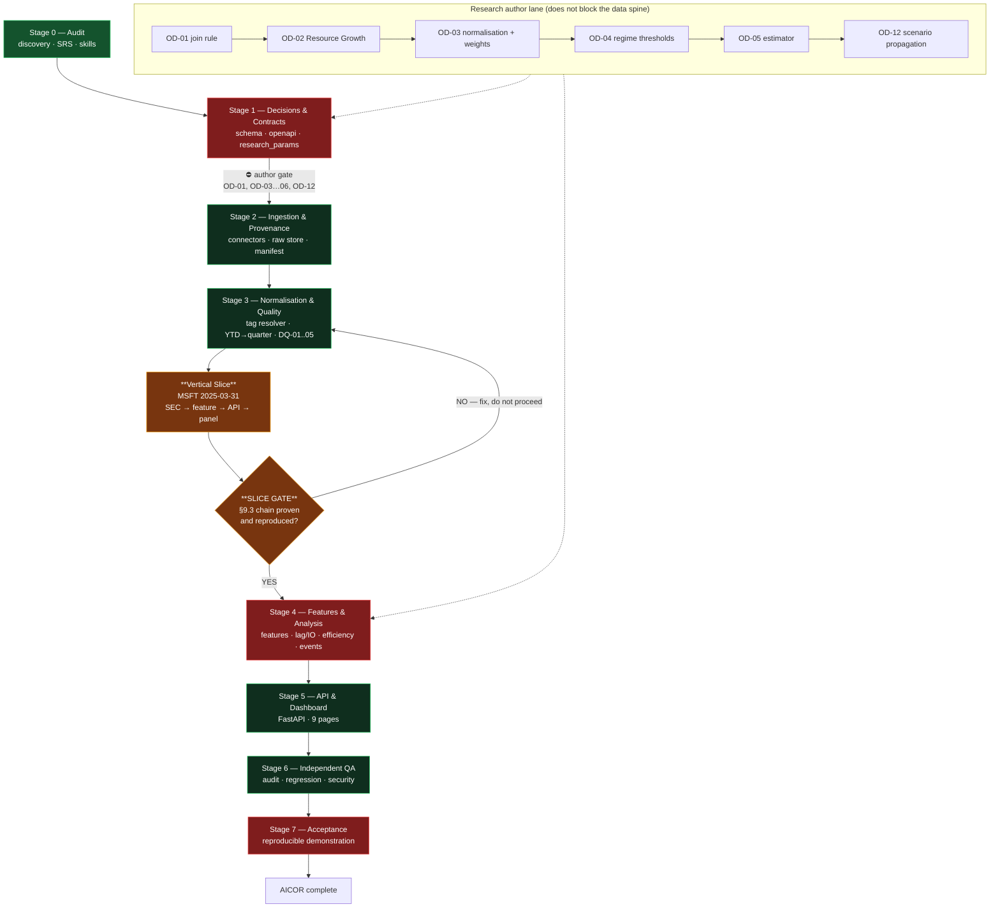
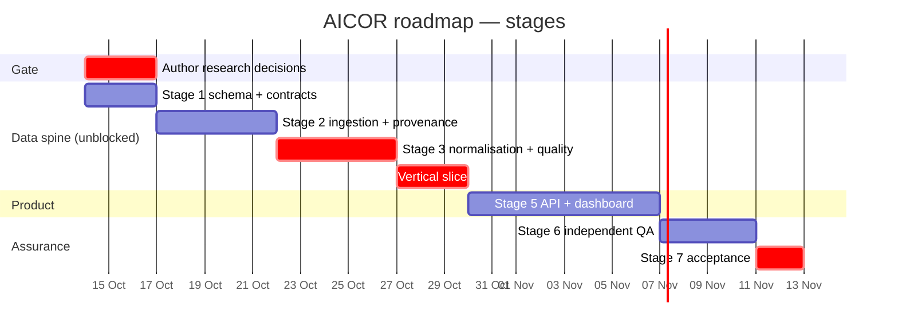

# AICOR — Implementation Roadmap

**Status:** Proposed · **Date:** 2026-10-13
**Organising principle:** a working, fully-provenanced **vertical slice** before breadth. Nothing scales until one number is provably traceable from the SEC filing to a pixel.

---

## 1. Stage overview

| Stage | Name | Entry condition | Exit criterion | Gate |
|---|---|---|---|---|
| 0 | Discovery, audit, SRS traceability | — | 11 planning docs + 6 ADRs merged; open decisions escalated | **DONE** |
| 1 | Decisions, schema, contracts | Stage 0 exit | `research_params.yaml` v1; migrations 0001–0003; `openapi.yaml` frozen; OD-01 confirmed | ⛔ author gate |
| 2 | Ingestion & provenance | Stage 1 schema + raw store | All 21 quarters × 2 companies in raw store with SHA-256 manifest; accessions discovered, not hard-coded | |
| 3 | Normalisation & data quality | Stage 2 | 21 quarterly rows per company per metric; DQ-01…05 green over real data | |
| 4 | Features & quantitative analysis | Stage 3 + **T-15 slice** | FE-01…04/08 + OUT-01…03; lag/IO/efficiency/event/regime/scenario complete **or** explicitly NULL pending a decision | ⛔ research gate |
| 5 | Backend API & dashboard | Stage 3 (API), Stage 4 (pages) | 9 pages live; zero client computation; every number traceable | |
| 6 | Independent QA, regression, docs | Stage 5 | Every requirement ID → TEST-ID → **executed result**; reproducibility double-run; security review clean | |
| 7 | Acceptance & demonstration | Stage 6 | SRS §9.3 walkable for one number on **each** of the 9 pages; reviewer reproduces independently | **FINAL GATE** |

---

## 2. Stage dependency graph

---

## 3. Stage detail

### Stage 0 — Discovery, audit, traceability · **COMPLETE**

| | |
|---|---|
| **Entry** | — |
| **Outputs** | `repository_audit.md`, `installed_skills_audit.md`, `srs_traceability_matrix.md`, `open_decisions.md`, `system_architecture.md`, `data_dictionary_and_provenance.md`, `api_contracts.md`, `multi_agent_work_plan.md`, `implementation_roadmap.md`, `test_and_acceptance_plan.md`, `risk_register.md`, ADRs 0001–0006 |
| **Exit** | All 11 documents merged; 62 coded requirements registered with status (14 blocked); 15 open decisions raised; 2 SRS defects fixed (`6d820aa`) |
| **Evidence** | Live verification of 13 URLs, 2 authentic accessions, 21 quarters, 1,512 market bars per symbol |

### Stage 1 — Decisions, schema, contracts

| | |
|---|---|
| **Entry** | Stage 0 exit |
| **Work** | T-05 (research decisions) · T-06 (scaffold + migrations) · freeze `openapi.yaml` + `research_params.yaml` |
| **Outputs** | Runnable repo; Postgres via compose; migrations 0001–0003; frozen contracts |
| **Exit** | Interface-freeze gate passed: OpenAPI + migrations + params + raw_manifest schema all merged |
| **Risk** | Freezing a contract around an undecided research parameter → mitigated by `pending_approval` (I-6) |

### Stage 2 — Ingestion & provenance

| | |
|---|---|
| **Entry** | Stage 1 schema + raw store |
| **Work** | T-07 → T-08…T-11 |
| **Outputs** | All filings + XBRL facts + IR pages + market CSVs in the immutable raw store, each with SHA-256, `access_date`, discovered accession |
| **Exit** | 21 quarters × 2 companies present in raw; **T-08 regression test passes** (the two SRS accessions discovered independently) |
| **Do not** | Re-fetch on a second run (MKT-03); hard-code any accession (I-4) |

### Stage 3 — Normalisation & data quality

| | |
|---|---|
| **Entry** | Stage 2 |
| **Work** | T-12 → T-13 → T-14 |
| **Outputs** | `financial_quarterly` 21×2 rows per metric; DQ-01…05 results |
| **Exit** | `FR_T01` (21 non-null quarters both companies) · `DQ_T04` (`A = L + E` for all 42) · `DQ_T03` (period basis on every fact) · no silent tag truncation |
| **Risk** | **Silent revenue truncation** (GOOGL's ASC 606 tag dies 2025-03-31) — hard fail, never skip |

### Stage 4 — Vertical slice, then breadth

| | |
|---|---|
| **Entry** | Stage 3 |
| **Slice** | MSFT · `2025-03-31` · `FY25Q3` · accession `0001193125-25-061046` · Revenue + R&D + CapEx · `CapEx/Revenue` · one panel |
| **Slice exit** | §9.3 chain proven **and independently reproduced** on a clean re-run |
| **Then** | T-16 features → T-17/T-18/T-19 analysis in parallel |
| **Blocked-until-approved** | FE-05…07, EFF-02, REG-01, SEN-01/ROB-01, SCN-01…03 — **structure ships, values stay NULL + `pending_decision`** |

**Why the slice is MSFT 2025-03-31:** fiscal Q3 gives a genuine 3-month income-statement column *and* a genuine 9-month cumulative cash-flow column in the same row, exercising both derivation paths; old enough to be final, new enough that both 9M and FY filings exist.

### Stage 5 — API & dashboard

| | |
|---|---|
| **Entry** | Stage 3 for the API; Stage 4 per page |
| **Work** | T-20 then T-21 page-by-page |
| **Outputs** | FastAPI + 9 pages, generated client, all loading/error/NULL states |
| **Exit** | `DSH_T01` — zero client computation, enforced by lint rule; `DSH_T02` — 9 routes; every headline number clickable to `source_url` |
| **Risk** | I-1 violation is the most likely defect → automated guard, not review discipline |

### Stage 6 — Independent QA

| | |
|---|---|
| **Entry** | Stage 5 |
| **Work** | T-22 — traceability audit, DQ report, reproducibility double-run, security review, regression ledger |
| **Exit** | Every requirement ID → TEST-ID → **executed result recorded**; zero mock rows in the analytical path; no secrets in the client bundle |
| **Independence** | Agent 5 owns no production code and cannot write upstream (layer 12 has no inbound write edges) |

### Stage 7 — Acceptance & demonstration

| | |
|---|---|
| **Entry** | Stage 6 |
| **Exit** | SRS §9.3 walkable for **at least one number on each of the 9 pages**; a reviewer reproduces results independently; §9.2 checklist evidenced |
| **Final check** | No fabricated data, no invented weights, every NULL explained, every conclusion carrying its assumptions |

---

## 4. Critical path & parallel windows

| Window | Parallelisable | Serialised (why) |
|---|---|---|
| Stage 1 | T-06 ‖ T-07 | Both touch the schema boundary — freeze first |
| Stage 2 | T-08 ‖ T-09 ‖ T-10 ‖ T-11 | Four independent connectors, one shared raw store (write-once makes this safe) |
| Stage 3 | — | **T-12 → T-13 → T-14 are strictly serial**; each consumes the previous one's output |
| Stage 4 | T-17 ‖ T-18 ‖ T-19 | All read the same frozen feature table |
| Stage 5 | T-21 pages in parallel | Only after each endpoint's contract lands |

**The longest serial chain is Stage 3 (tag resolver → derivation → quality).** It is also where the two highest-severity defects live, so it is deliberately not parallelised.

## 5. Rollback & failure handling

| Failure | Response |
|---|---|
| Tag resolution finds no source for a required quarter | **Hard fail**, `data_quality_log` ERROR. Never skip — skipping is the truncation defect |
| Derivation cross-check disagrees (MSFT direct vs derived) | Row kept but flagged ERROR; pipeline continues; surfaced on dashboard page 09 |
| Connector 429 / 5xx | Exponential backoff with jitter, token-bucket ≤10 req/s, identified User-Agent |
| Connector permanently fails | `status='unavailable'` + `reason` (SRC-05). **Never fabricate, never estimate** |
| Research decision unapproved at Stage 4 | Ship structure with NULL + `pending_decision`; do not block the rest |
| Postgres unavailable | Stage 1 exit fails; `docker-compose.yml` verified running before Stage 3 |
| Raw snapshot corrupted | `raw_manifest` hash mismatch → re-fetch is a *new* row; provenance of the old value preserved as `superseded` |
| Reproducibility double-run differs | **Blocks Stage 7.** Locate the nondeterminism before any further work |

## 6. Definition of done per stage

A stage is done when, and only when, every task in it has: (a) all deliverables present, (b) its acceptance criteria verified by **executed evidence** — not assertion, (c) requirement IDs mapped to TEST-IDs, (d) tests written and passing, (e) no mock data in an acceptance path, (f) provenance complete for every value it introduced. "Implemented" without (b) is not done.