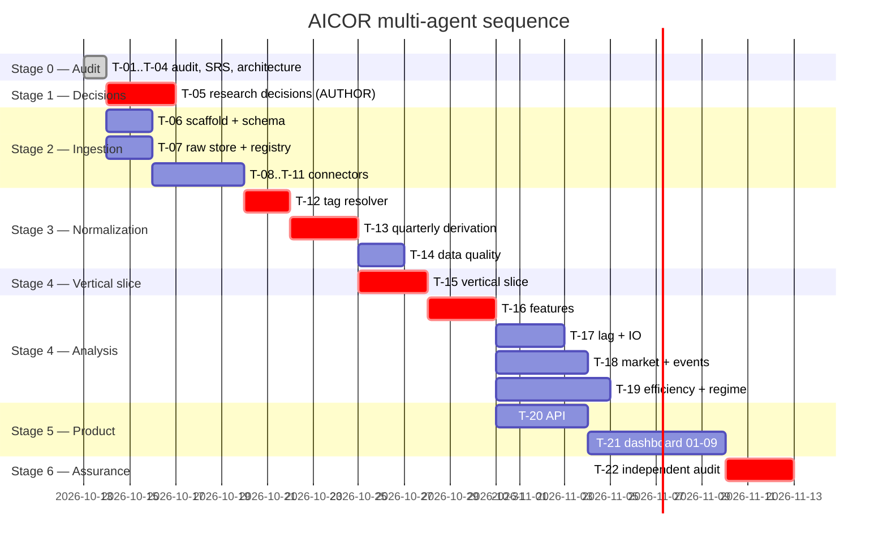

# AICOR — Multi-Agent Work Plan

**Status:** Proposed — **not authorized to execute** · **Date:** 2026-10-13
**Roles:** Agent 0 Architect · Agent 1 Data Eng · Agent 2 Quant · Agent 3 Backend/DB · Agent 4 Frontend · Agent 5 QA
**Dispatch rule:** no agent starts implementation until its *input dependencies* are merged **and** the shared interfaces it touches are frozen.

---

## 1. Shared-file conflicts and resolution

Resolved **before** any parallel dispatch. One owner per module.

| File / module | Conflict risk | Resolution |
|---|---|---|
| `config/research_params.yaml` | Agent 2 needs parameters that Agent 0 must approve; a research decision could be settled silently in code | **Agent 2 writes, Agent 0 approves.** New entries land as `pending_approval: true`; only Agent 0 promotes them. |
| `docs/openapi.yaml` | Agent 3 provides; Agent 4 consumes; drift would be silent | **Agent 3 owns the file.** Agent 4 may not edit it — only raise a change request. |
| `migrations/*` | Concurrent schema edits collide | **Agent 3 owns exclusively.** Other agents request schema via Agent 3. |
| `docs/planning/*`, `docs/adr/*` | Everyone wants to annotate | **Agent 0 owns exclusively.** |
| `data/raw/**` | Parallel ingestion could clobber | Content-addressed write-once (I-2); `write_raw()` refuses an existing hash. Parallel-safe by construction. |
| `tests/**` | Agents 1–3 want to write tests for their own code | Agents 1–3 write tests **in their own modules**; **Agent 5 owns `tests/audit/` and the acceptance suites** and cannot be asked to rubber-stamp its own findings. |

**Interface freeze gate.** Before any fan-out, these four artifacts must be merged:
`docs/openapi.yaml` (Agent 3) · migration set `0001–0003` (Agent 3) · `config/research_params.yaml` v1 (Agent 0) · `raw_manifest` schema (Agent 1).

---

## 2. Task index

| ID | Agent | Objective | Parallel? | Depends on |
|---|---|---|---|---|
| T-01 | 0 | Repo + SRS audit | — | done |
| T-02 | 0 | Skill audit | — | done |
| T-03 | 0 | SRS traceability + open decisions | — | T-01 |
| T-04 | 0 | Architecture + data dictionary + API contract | — | T-03 |
| T-05 | 0 | Research decisions OD-01…OD-06, OD-12 | ⛔ **blocking for Stage 4** | author |
| T-06 | 1 | Project scaffold + DB schema + migrations | ✅ ‖ T-07 | T-04 |
| T-07 | 1 | Source registry + raw store + manifest | ✅ ‖ T-06 | T-04 |
| T-08 | 1 | SEC `submissions` connector | ✅ ‖ T-09 | T-07 |
| T-09 | 1 | SEC `companyconcept` connector | ✅ ‖ T-08 | T-07 |
| T-10 | 1 | IR connector (Tier A operating metrics) | ✅ ‖ T-08, T-09 | T-07 |
| T-11 | 1 | Yahoo market connector | ✅ ‖ T-08, T-09, T-10 | T-07 |
| T-12 | 1 | Period-aware tag resolver | ⛔ single-owner | T-09 |
| T-13 | 1 | Cumulative → quarterly derivation + cross-check | ⛔ single-owner | T-12 |
| T-14 | 1 | DQ-01…DQ-05 checks | ✅ after T-13 | T-13 |
| **T-15** | 1+2+3+4 | **Vertical slice (MSFT 2025-03-31)** | ⛔ sequential | T-13 |
| T-16 | 2 | Feature engineering FE-01…04, FE-08, OUT-01…03 | ⛔ after T-15 | T-15 |
| T-17 | 2 | Lag + IO analysis | ✅ ‖ T-18 | T-16, **T-05** |
| T-18 | 2 | Market output + event study | ✅ ‖ T-17 | T-16, T-11 |
| T-19 | 2 | Efficiency, regime, sensitivity, robustness, scenario | ✅ ‖ T-17, T-18 | T-16, **T-05** |
| T-20 | 3 | API routers + provenance endpoint | ✅ ‖ T-17…19 | T-04, T-16 |
| T-21 | 4 | Dashboard pages 01–09 | ✅ ‖ T-20 per page | T-20 |
| T-22 | 5 | Independent audit + regression + traceability | ⛔ last | all |

---

## 3. Task specifications

### T-04 · Architecture contracts — **Agent 0**
- **Deliverables:** `system_architecture.md`, `data_dictionary_and_provenance.md`, `api_contracts.md`, ADRs 0001–0006.
- **Reqs:** all (governs all).
- **Deps:** T-03.
- **Files:** `docs/planning/`, `docs/adr/`.
- **Exclusions:** no application code.
- **Acceptance:** every SRS table has a table; every FE/EFF/EVT has a formula; open questions escalated not invented.
- **Tests:** document review; schema-review checklist.
- **Risks:** freezing a contract too early; mitigated by marking research-parameter fields `pending_approval`.
- **Parallel:** no. **Integration owner:** Agent 0.

### T-05 · Research decisions — **Agent 0 → research author** ⛔
- **Deliverables:** answered OD-01…OD-06, OD-12, each recorded as an ADR with rationale.
- **Reqs:** FE-05…07, EFF-01/02, SEN-01, ROB-01, DEC-01, REG-01, SCN-01…03, IO-02, DAT-01.
- **Exclusions:** Agent 0 must **not** decide these unilaterally.
- **Acceptance:** each OD has an explicit decision + rationale, or a documented deferral.
- **Risks:** silently inventing weights would fabricate research methodology — the single most damaging failure mode in this project.
- **Parallel:** blocks T-17 and T-19 only; **Stage 2/3 and T-16 proceed regardless.**

### T-06 · Scaffold + schema — **Agent 1**
- **Deliverables:** `pyproject.toml`, `uv.lock`, `docker-compose.yml`, `.env.example`, migrations `0001` (companies/filing/raw_manifest) `0002` (financial/segments/market/events) `0003` (features/analysis/scenarios/dq_log).
- **Reqs:** §6.2, PRV-01, DAT-01.
- **Files:** `aicor/db/`, `migrations/`, `pyproject.toml`.
- **Exclusions:** no connectors, no analysis.
- **Acceptance:** migrations apply and roll back cleanly on an empty DB; PKs enforce I-5; `capex ≥ 0` check exists.
- **Tests:** migration up/down; PK uniqueness on `(company_id, period_end_date)`.
- **Risks:** Postgres unavailable locally → `docker-compose.yml` must be verified running before Stage 3.
- **Parallel:** yes, ‖ T-07. **Integration owner:** Agent 3 (schema authority).

### T-07 · Source registry + raw store — **Agent 1**
- **Deliverables:** `aicor/raw/` content-addressed store, `raw_manifest` writer, registry CRUD, `config/research_params.yaml` scaffold.
- **Reqs:** SRC-01, SRC-03, SRC-07, MKT-03, I-2.
- **Files:** `aicor/raw/`, `aicor/ingest/registry.py`.
- **Exclusions:** no network calls.
- **Acceptance:** writing the same bytes twice yields one manifest row; a different hash yields a new row; an existing hash is never overwritten.
- **Tests:** idempotency; tamper-detection (modified bytes → new hash, not a silent overwrite).
- **Parallel:** yes, ‖ T-06. **Owner:** Agent 1.

### T-08 · SEC `submissions` connector — **Agent 1**
- **Deliverables:** connector returning form/accession/period/filed for both CIKs; populates `filing`; rate limiter + UA + backoff.
- **Reqs:** SRC-04, SRC-07, I-4, OD-14.
- **Acceptance:** discovers all 10-Q/10-K covering 2021-06-30→2026-06-30; **reproduces the two SRS accessions exactly** (already verified to match — a regression guard).
- **Tests:** live integration test asserting `0001193125-26-191507` (MSFT, 2026-03-31) and `0001652044-26-000071` (GOOGL, 2026-06-30) are discovered; rate-limit/backoff unit test with a mocked 429.
- **Risks:** SEC throttling → token-bucket ≤10 req/s, UA identifying the project.
- **Parallel:** yes.

### T-09 · SEC `companyconcept` connector — **Agent 1**
- **Deliverables:** per `(company, tag)` fact fetch → raw snapshot → parsed facts with `period_basis`, `accession_number`, `form`.
- **Reqs:** FR-01…05, SRC-03, SRC-07.
- **Acceptance:** all §6.3 metrics retrievable for both companies over 21 quarters; each fact carries its source accession.
- **Tests:** schema validation; fact→accession FK integrity.
- **Parallel:** yes.

### T-10 · IR connector — **Agent 1**
- **Deliverables:** Tier A operating metrics (Azure growth, MS Cloud growth, Google Cloud growth), regex-first extraction with confidence, low-confidence → manual queue.
- **Reqs:** FR-06, FR-07, SRC-06, SRC-07, EVT-02.
- **Exclusions:** **no LLM extraction, no guessed values** (`regex-vs-llm-structured-text`: regex first, escalate only low-confidence).
- **Acceptance:** each metric present or `status='unavailable'` + reason; prefer segment XBRL (Tier S) over scraping wherever available (OD-14).
- **Tests:** extraction fixtures per page layout; 100% Tier A/S with resolvable URLs.
- **Risks:** IR page layout changes → fixture regression tests + manual-queue fallback.
- **Parallel:** yes.

### T-11 · Yahoo market connector — **Agent 1**
- **Deliverables:** MSFT, GOOGL, `^GSPC` daily bars → `data/raw/market/*.csv` + manifest; `adjusted_close` mandatory.
- **Reqs:** SRC-02, MKT-01…04.
- **Acceptance:** one download, committed CSV + SHA-256 + `access_date`; **`adjusted_close` present for all three symbols** (verified working: 1,512 bars, no auth); missing trading dates recorded, not interpolated.
- **Tests:** date-continuity check; `adjusted_close` non-null assertion; **second run must not re-fetch** (MKT-03).
- **Risks:** Yahoo ToS (personal/educational) and retroactive adjustment → documented limitation; snapshot-once mitigates.
- **Parallel:** yes.

### T-12 · Period-aware tag resolver — **Agent 1** ⛔ single-owner
- **Deliverables:** metric→candidate-tag table; per-period resolution; chosen tag recorded in `source_registry.xbrl_tag`; hard failure when a required quarter resolves to nothing.
- **Reqs:** FR-01, SRC-07, OD-08.
- **Exclusions:** no per-company hard-coded tag.
- **Acceptance:** `FR_T01` — 21 non-null revenue quarters for both companies. Must demonstrably handle GOOGL's tag dying at 2025-03-31 and MSFT's legacy `Revenues` dying in 2010.
- **Tests:** regression fixtures for both discontinuity shapes; **a test asserting a missing tag raises rather than skips**.
- **Risks:** **silent truncation** — the highest-severity defect in Phase 1. Mitigation: hard fail + `FR_T01`.
- **Parallel:** no — critical path.

### T-13 · Cumulative → quarterly derivation — **Agent 1** ⛔ single-owner
- **Deliverables:** Q1=`3M`; Q2=`6M−3M`; Q3=`9M−6M`; **Q4=`FY−9M`**; `period_basis` on every fact; MSFT direct-3M cross-check with tolerance comparison.
- **Reqs:** DQ-03, FR-03, FR-05, OD-13.
- **Acceptance:** 21 quarters × 2 companies for revenue/R&D/capex/CFO; Q4 present for every year; cross-check mismatch → `data_quality_log` ERROR, row kept but flagged.
- **Tests:** unit tests on the four formulas incl. FY−9M with known values; **a test proving no Q4 is ever read as a 3-month fact**; cross-check agrees for MSFT's 14 direct quarters.
- **Risks:** mis-assigned fiscal quarter for MSFT's July–June year → test on a known quarter boundary.
- **Parallel:** no — critical path.

### T-14 · Data quality checks — **Agent 1**
- **Deliverables:** DQ-01…DQ-05 executable checks → `data_quality_log` with `expected`/`actual`/`severity`.
- **Reqs:** DQ-01…DQ-05.
- **Acceptance:** DQ-02 sign check; DQ-03 period-basis check; **DQ-04 `Assets = Liabilities + Equity` within tolerance for all 42 company-quarters**; DQ-05 SEC-vs-IR with SEC canonical.
- **Tests:** each check has a unit test **and** runs green against real SEC data; a deliberately corrupted fixture must fail the check.
- **Risks:** thresholds hard-coded → must live in versioned config (I-6).
- **Parallel:** after T-13.

### T-15 · **Vertical slice** — Agents 1 + 2 + 3 + 4 ⛔ sequential, gated
- **Objective:** one company, one quarter, one real source, one verified metric, one derived feature, one API response, one dashboard panel, **complete provenance**.
- **Scope:** MSFT · `period_end_date = 2025-03-31` (FY25Q3) · accession `0001193125-25-061046` · Revenue, R&D, CapEx · `CapEx/Revenue` · `GET /features?feature=capex_intensity` · one panel.
- **Why this quarter:** it has a genuine 3-month income-statement column **and** a 9-month cumulative cash-flow column, so it exercises both the easy and the hard derivation path in one row; it is old enough to be final (no restatement risk) and recent enough that 9M and FY filings both exist.
- **Acceptance (§9.3 chain):** panel value → analysis result → feature → calculation → raw file → `source_id` → `source_url` → SEC filing, **reproduced by a reviewer on a clean re-run**.
- **Tests:** provenance walk test; reproducibility re-run comparison; `NFR_T02`; no frontend arithmetic (`DSH_T01`).
- **Risks:** none material — everything in scope is unblocked by research decisions.
- **Parallel:** no. **Integration owner:** Agent 0.

### T-16 · Feature engineering — **Agent 2**
- **Deliverables:** FE-01…04, FE-08, OUT-01…03 into `features_quarterly` with 12 PRV-01 fields + `input_feature_ids`.
- **Reqs:** FE-01…04, FE-08, OUT-01…03, PRV-01.
- **Deps:** T-15.
- **Exclusions:** **FE-05…07 excluded** (OD-02 unresolved).
- **Acceptance:** FE-08 NULL guards for zero / near-zero / negative-base denominators (FCF sign change included); first 4 quarters NULL+reason for YoY; every row carries `definition` + `calculation_method` + `config_version`.
- **Tests:** formula unit tests; synthetic zero/negative/sign-change fixtures; SRC-06 confidence mapping asserted per row.
- **Risks:** threshold for "near zero" is a research parameter → config + `pending_approval` (I-6).
- **Parallel:** no — everything downstream depends on it.

### T-17 · Lag + IO analysis — **Agent 2** ✅ ‖ T-18
- **Deliverables:** 4 relationships × 5 lags × 2 companies = 40 `analysis_results` rows with `method`, `n_observations`, bootstrap CI, `result_class='association'`.
- **Reqs:** LAG-01, LAG-02, IO-01, IO-02, CAU-01.
- **Deps:** T-16 **+ T-05 (OD-05)**.
- **Exclusions:** no Granger, no p-value ranking, no single "best lag" endpoint (lag-profile returns all five).
- **Acceptance:** `IO_T01` — 40 results; `n_observations ≈ 13` recorded honestly; CI spanning zero is displayed as uncertainty; **no output string matches `caused|causes|led to`**.
- **Tests:** deterministic seed → identical re-run; `n_observations` matches the drop rule; CAU-01 string guard.
- **Risks:** small-sample over-reading → CI + `limitations` mandatory (NFR-04).
- **Parallel:** yes, ‖ T-18.

### T-18 · Market output + event study — **Agent 2** ✅ ‖ T-17
- **Deliverables:** OUT-03 series; EVT-01…03 with CAR, expected return, benchmark version, `cluster_id`.
- **Reqs:** OUT-03, EVT-01, EVT-02, EVT-03, MKT-04.
- **Deps:** T-16, T-11.
- **Exclusions:** no events without a Tier A/S source; no padding to reach all 8 event types.
- **Acceptance:** CAR over exactly 21 trading days; `forward_1_quarter_abnormal_return` NULL for the final quarter with reason (OD-15); overlapping windows grouped (OD-11).
- **Tests:** CAR window length assertion; **earnings windows provably cannot overlap** (~63 trading days apart vs a 21-day window) with a clustering test; every event has a resolvable Tier A/S URL.
- **Risks:** IR-sourced events may be sparse → an explicit "none found" record rather than invention.
- **Parallel:** yes.

### T-19 · Efficiency, regime, sensitivity, robustness, scenario — **Agent 2** ✅ ‖ T-17, T-18
- **Deliverables:** EFF-01/02, REG-01, SEN-01, ROB-01, SCN-01…03, RSK-01.
- **Reqs:** EFF-01, EFF-02, REG-01, SEN-01, ROB-01, SCN-01…03, RSK-01, DEC-03.
- **Deps:** T-16 **+ T-05 (OD-02, OD-03, OD-04, OD-12)**.
- **Exclusions:** **may not proceed on invented weights, thresholds or elasticities.** If a decision is unapproved, the task ships the *structure* with NULL + `pending_decision` and stops.
- **Acceptance:** EFF-01 shows the five measures **before** any composite; `weight_version`/`weights`/`normalization_method` persisted; REG-01 assigns exactly one regime per quarter with reason; ROB-01 emits ROBUST/SENSITIVE + reversal reason; scenarios are arithmetic-only and labelled ASSUMPTION.
- **Tests:** weights sum to 1.00; `weight_version` persisted; REG-01 partitions all 42 quarters exactly once; ROB-01 flips correctly on a synthetic reversal; scenario effects null where an elasticity would be needed.
- **Risks:** highest temptation to invent → `pending_approval` gate blocks promotion.
- **Parallel:** yes.

### T-20 · Backend API — **Agent 3**
- **Deliverables:** FastAPI app, routers, Pydantic v2 schemas, `docs/openapi.yaml`, provenance + data-quality endpoints, uniform error envelope.
- **Reqs:** DSH-01, PRV-01, NFR-02, NFR-03.
- **Deps:** T-04, T-16 (T-17…19 add endpoints).
- **Exclusions:** **no computation of financial or analytical values** (C-1); no secrets in responses.
- **Acceptance:** OpenAPI validates; every payload carries provenance; NULL delivered as `value:null` + `status` + `reason`; `decision.limitations` non-nullable; `/coverage` returns the true available-quarter map.
- **Tests:** contract tests; response-schema tests incl. NULL shape; a test asserting no endpoint performs aggregation; error-envelope tests.
- **Risks:** endpoint drift from OpenAPI → CI contract check.
- **Parallel:** yes, ‖ T-17…19.

### T-21 · Dashboard — **Agent 4**
- **Deliverables:** Next.js app, 9 pages, generated OpenAPI client, shared `format.ts`, loading/error/NULL/empty states, responsive + a11y.
- **Reqs:** DSH-01, DSH-02, AI-03, FE-01…08 presentation.
- **Deps:** T-20 per page (pages 02/05/07 need T-17…19 data).
- **Exclusions:** **no arithmetic on API data whatsoever**; no raw "AI Investment" label (AI-03).
- **Acceptance:** 9 routes; every endpoint's loading/error/NULL state implemented; every headline number clickable through to `source_url`; **ESLint rule + review gate proving zero computation**; `AI_T02` string guard passes.
- **Tests:** component tests for NULL + error states; Playwright E2E over all 9 pages; axe accessibility pass; **a source-inspection test failing if client arithmetic is introduced**.
- **Risks:** I-1 violation is the highest-likelihood defect here → automated lint rule, not review discipline.
- **Parallel:** yes, page-by-page after each endpoint lands.

### T-22 · Independent audit — **Agent 5** ⛔ last
- **Deliverables:** traceability audit against every requirement ID, DQ reports over real data, reproducibility re-run, security review, regression ledger, acceptance report.
- **Reqs:** all; SRS §9.1–9.3.
- **Deps:** all tasks.
- **Exclusions:** **may not modify upstream data or code** — reports defects to the owning agent (layer 12 has no inbound write edges).
- **Acceptance:** every requirement ID mapped to a TEST-ID and an **actual executed result**; §9.3 chain walked for at least one number per dashboard page; NFR-01 double-run byte-comparison; zero mock rows in the analytical path; no secrets in the client bundle.
- **Tests:** `test_and_acceptance_plan.md` executed in full with recorded output.
- **Risks:** rubber-stamping its own work → Agent 5 owns no production code.
- **Parallel:** no.

---

## 4. Execution sequence

**Critical path:** T-04 → T-07 → T-09 → **T-12** → **T-13** → T-15 → T-16 → T-17/T-19 → T-22.
**T-05 (research decisions) is critical only for T-17/T-19** — Stages 2, 3 and T-16 proceed while it is pending. That is deliberate: the long data spine must not wait on methodology choices.

## 5. First vertical slice — recommended

**MSFT · `period_end_date = 2025-03-31` · `FY25Q3` · 10-Q accession `0001193125-25-061046` · Revenue + R&D + CapEx · `CapEx/Revenue` · one panel, full provenance.**

Rationale for this specific quarter: it is MSFT fiscal Q3, so it has a real 3-month income-statement column **and** a real 9-month cumulative cash-flow column — one row exercises both the easy and the hard derivation path. It is old enough to be unambiguously final (no later-filing restatement risk) and recent enough that both the 9M and FY filings exist.

**Gate:** the §9.3 chain walks end-to-end and a reviewer reproduces the value on a clean re-run. Only then do Tasks T-16 onward fan out.