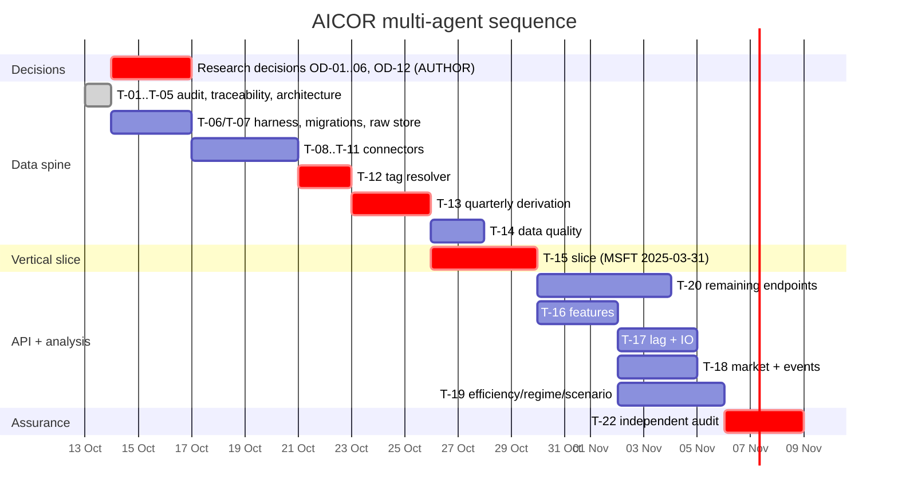

# AICOR — Multi-Agent Work Plan

**Status:** Proposed — **not authorized to execute** · **Date:** 2026-10-13
**Roles:** Agent 0 Architect · Agent 1 Data Eng · Agent 2 Quant · Agent 3 Backend/DB · Agent 4 Frontend · Agent 5 QA

> **Task specifications live in the implementation plans.** Per skill `writing-plans`, this file is the orchestration index — who owns what, what blocks what, and which plan a task belongs to. Task steps, interfaces and tests are **not** duplicated here; a second copy would drift.

| Plan | Covers | Blocking |
|---|---|---|
| [`2026-10-13-aicor-data-spine.md`](../superpowers/plans/2026-10-13-aicor-data-spine.md) | T-01…T-14: harness, migrations, raw store, SEC + market connectors, tag resolution, quarterly derivation, DQ checks | — |
| [`2026-10-13-aicor-vertical-slice.md`](../superpowers/plans/2026-10-13-aicor-vertical-slice.md) | T-15: MSFT `2025-03-31` end-to-end, contract-first, §9.3 chain | — |
| [`2026-10-13-aicor-api-contract.md`](../superpowers/plans/2026-10-13-aicor-api-contract.md) | T-20: all remaining endpoints, contract drift gate | needs slice |
| [`2026-10-13-aicor-analysis.md`](../superpowers/plans/2026-10-13-aicor-analysis.md) | T-16…T-19: features, lag/IO, efficiency, events, regime, scenarios | **held on OD-02…OD-05, OD-12** |

---

## 1. Dispatch rule

**No agent starts until its plan's prerequisites are met and the shared interfaces it touches are frozen.**

Per skill `subagent-driven-development`, execution of each plan is task-by-task: a fresh implementer writes the code from the task's steps, then a **fresh reviewer** verifies it before the next task begins. Implementer and reviewer are never the same agent.

## 2. Shared-file conflicts and resolution

One owner per module. Agreed **before** any fan-out.

| File / module | Conflict risk | Resolution |
|---|---|---|
| `config/research_params.yaml` | Agent 2 needs parameters Agent 0 must approve; a research decision could be settled silently in config | **Agent 2 writes, Agent 0 promotes.** New entries land `pending_approval: true`; only Agent 0 clears the flag. ADR-0006. |
| `docs/openapi.yaml` | Agent 3 provides, Agent 4 consumes; drift would be silent | **Agent 3 owns the file** (single writer). But per `contract-first`, **Agent 4 authors the consumer jobs first** — ownership is not sole authorship. Agent 4 may not edit the artifact; it raises a change request. |
| `migrations/*` | Concurrent schema edits collide | **Agent 3 owns exclusively.** Other agents request schema changes via Agent 3. Migrations are test-first (author decision, 2026-10-13). |
| `docs/superpowers/plans/*` | Everyone wants to annotate | **Agent 0 owns exclusively.** |
| `docs/planning/*`, `docs/adr/*` | Everyone wants to annotate | **Agent 0 owns exclusively.** |
| `data/raw/**` | Parallel ingestion could clobber | Content-addressed write-once (I-2); `write_raw()` refuses an existing hash. Parallel-safe by construction. |
| `aicor/api/schemas_generated.py`, `web/src/generated/api.ts` | Hand edits would silently diverge from the contract | **Generated — never hand-edited.** Both carry a generated header; `test_generated_is_current` fails if regeneration produces a diff. |
| `tests/**` | Agents 1–3 want tests for their own code | Agents 1–3 write tests **inside their own modules**; **Agent 5 owns `tests/audit/`** and the acceptance suites. Agent 5 owns no production code, so it can never rubber-stamp its own work. |

## 3. Ownership

| Path | Owner | Consumed by |
|---|---|---|
| `aicor/ingest/`, `aicor/raw/`, `aicor/quality/` | Agent 1 | Agents 2, 3 |
| `aicor/features/`, `aicor/analysis/` | Agent 2 | Agent 3 |
| `config/research_params.yaml` | Agent 2 writes, **Agent 0 approves** | Agents 1, 2 |
| `aicor/db/`, `migrations/`, `aicor/api/`, `docs/openapi.yaml` | Agent 3 | Agents 4, 5 |
| `web/` | Agent 4 | Agent 5 |
| `tests/audit/` | Agent 5 | all |
| `docs/adr/`, `docs/planning/`, `docs/superpowers/plans/` | Agent 0 | all |

## 4. Interface-freeze gate

Before any fan-out, these four artifacts must be merged — the contract-first analogue of the old freeze list:

1. `docs/openapi.yaml` (Agent 3, after Agent 4's consumer jobs)
2. `config/research_params.yaml` v1 (Agent 0)
3. `raw_manifest` schema, via migration `0001` (Agent 1)
4. The Python interfaces named in each plan's **Interfaces** blocks (Agents 1, 3)

## 5. Task index

| ID | Agent | Objective | Plan | Parallel? | Depends on |
|---|---|---|---|---|---|
| T-01…T-05 | 0 | Audit, traceability, architecture, decisions | — | — | done |
| T-06 | 1 | Scaffold + migrations 0001–0002 | data-spine T1–T3 | ✅ ‖ T-07 | freeze |
| T-07 | 1 | Raw store + manifest | data-spine T4 | ✅ ‖ T-06 | freeze |
| T-08 | 1 | SEC `submissions` connector | data-spine T5 | ✅ ‖ T-09 | T-07 |
| T-09 | 1 | SEC `companyconcept` connector | data-spine T6 | ✅ ‖ T-08 | T-07 |
| T-11 | 1 | Yahoo market connector | data-spine T11 | ✅ ‖ T-08/09 | T-07 |
| T-10 | 1 | IR connector | — | ✅ ‖ T-08 | T-07 |
| T-12 | 1 | **Period-aware tag resolver** | data-spine T7 | ⛔ critical path | T-09 |
| T-13 | 1 | **Quarterly derivation** | data-spine T8 | ⛔ critical path | T-12 |
| T-14 | 1 | DQ-01…DQ-05 | data-spine T10 | after T-13 | T-13 |
| **T-15** | 1+2+3+4 | **Vertical slice** | vertical-slice | ⛔ sequential | T-13 |
| T-16 | 2 | Features FE-01…04/08, OUT-01…03 | analysis T1–2 | after T-15 | T-15 |
| T-17 | 2 | Lag + IO | analysis T3 | ✅ ‖ T-18 | T-16, **OD-05** |
| T-18 | 2 | Market output + event study | analysis T6 | ✅ ‖ T-17 | T-16, T-11 |
| T-19 | 2 | Efficiency, regime, sensitivity, scenario | analysis T4,5,7 | ✅ ‖ T-17/18 | **OD-02/03/04/12** |
| T-20 | 3 | API endpoints + drift gate | api-contract | ✅ ‖ T-17…19 | T-15 |
| T-21 | 4 | Dashboard pages 01–09 | — | ✅ ‖ per page | T-20 |
| T-22 | 5 | Independent audit | — | ⛔ last | all |

## 6. Execution sequence

**Critical path:** freeze → T-07 → T-09 → **T-12** → **T-13** → T-15 → analysis → T-22.

**Research decisions are critical only for T-17 and T-19.** Stages 2–3, the vertical slice, and T-16 proceed while they are pending. That is deliberate: the long data spine must not wait on methodology choices. Held analysis tasks ship **structure with NULL + `pending_decision`**, never a fabricated value.

## 7. First vertical slice

**MSFT · `period_end_date = 2025-03-31` · `FY25Q3` · 10-Q accession `0001193125-25-061046` · Revenue + R&D + CapEx · `CapEx/Revenue` · one panel, full provenance.**

Why this quarter: fiscal Q3 gives a genuine 3-month income-statement column **and** a genuine 9-month cumulative cash-flow column in the same row, so it exercises both derivation paths. Old enough to be unambiguously final (no later-filing restatement risk); recent enough that both the 9M and FY filings exist.

**Gate:** the SRS §9.3 chain walks end to end and a reviewer reproduces the value on a clean re-run. Only then do T-16 onward fan out. Full acceptance criteria: `docs/superpowers/plans/2026-10-13-aicor-vertical-slice.md` §Exit Criteria (A1–A8).

## 8. Deviations from skill defaults, and why

| Skill default | Deviation | Reason |
|---|---|---|
| `subagent-driven-development` — fresh implementer + reviewer per task | Preserved | — |
| Agent 3 owns `openapi.yaml` as single writer | **Relaxed:** Agent 4 authors consumer jobs first | `contract-first` requires consumer-first; ownership is not sole authorship |
| No auth layer in the API | **Preserved deviation** | The API serves public filings; no mutation exists. Recorded as an accepted NFR gap (OD-06), not silently omitted |
| Frontend plan not yet written | Deferred | It consumes endpoints from the API plan through the generated client; writing it earlier would produce a contract it cannot be tested against |