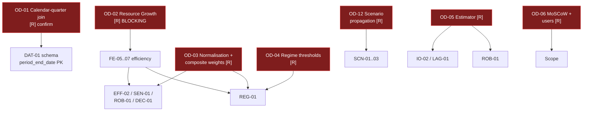

# AICOR — Open Decisions Register

**Status:** Awaiting author decision · **Date:** 2026-10-13
**Rule in force:** *no research assumption will be invented.* Every value below is either an observed fact, an engineering choice I can defend, or an explicit escalation.

**Two classes:**

| Class | Meaning | Who decides |
|---|---|---|
| **[R] Research** | A defensible choice exists only after a research judgement. Inventing it silently would put fabricated methodology into the results. | **Research author.** Blocking. |
| **[E] Engineering** | Multiple workable options; I recommend one, state the trade-off, and proceed on the recommendation unless overruled. | Agent 0, with notice. Non-blocking. |

---

## Blocking research decisions

### OD-02 · Definition of "Resource Growth" — *the single highest-impact gap* · **[R]**

**Problem.** FE-05, FE-06 and FE-07 are all specified as `X Efficiency = X Growth / Resource Growth`. **No requirement anywhere in the SRS defines what "Resource Growth" is.** EFF-01 then lists four efficiency measures that all divide by this same undefined term, and REG-01 classifies operating regimes using "Financial Efficiency", inheriting the same gap.

**Impact.** Blocks FE-05, FE-06, FE-07, EFF-01, EFF-02, REG-01, RQ-03, RQ-06. That is the entire Efficiency and Regime half of the system — dashboard pages 05 and 07.

**Why it cannot be defaulted silently.** Each option below yields a *different* answer to the project's headline question ("who converts investment more efficiently?"). Choosing one is a research statement, not an implementation detail.

| Option | Definition | Consequence |
|---|---|---|
| **A** | CapEx YoY growth | Answers *"is capital intensity paying off?"* — narrow, but the cleanest read of "AI infrastructure build-out". Ignores R&D. |
| **B** | R&D YoY growth | Answers *"is R&D paying off?"* — R&D is a weaker AI proxy (LOW confidence per SRC-06). |
| **C** | Both, kept separate — efficiency computed twice, once per denominator | No single "the" efficiency number; doubles the output set. **Most honest**, most work, and it avoids collapsing two different causal stories into one ratio. |
| **D** | Composite resource growth = `w·CapEx growth + (1−w)·R&D growth` | Requires choosing `w` — which re-imports OD-03 (undefined weights) one level earlier. **Weakest option; not recommended.** |

**Recommendation: Option C** — compute efficiency against both denominators and report them separately, because CapEx and R&D are different *kinds* of resource with different confidence levels (SRC-06: CapEx = MEDIUM, R&D = LOW). Collapsing them into one ratio would disguise that asymmetry behind a single number.

**Needed from you:** choose A, B, or C. If A or B, the losing denominator's efficiency is simply absent.

---

### OD-03 · Normalisation method and composite-score weights · **[R]**

**Problem.** Two related gaps the SRS itself flags as B-03:

1. **EFF-02** gives weights `0.30 Revenue + 0.30 Operating + 0.25 FCF + 0.15 Market`, but **defines no `normalisation_method`**. The four components are incommensurable: efficiency ratios are scale-free ratios of growth rates, while Market Efficiency is an abnormal *return* measured in percent. Adding them weighted is meaningless until they share a scale.
2. **DEC-01** introduces `composite_score` over `{financial, ai_efficiency, market, risk}` — a *different* four-part composite that additionally contains a risk component EFF-02 does not. **No formula is given for `composite_score` at all**, nor for the SEN-01 weight sets (`Baseline`, `Financial-heavy`, `Efficiency-heavy`, `Market-heavy`, `Risk-heavy`), which are named but have no numbers.

**Impact.** Blocks EFF-02, SEN-01, ROB-01, DEC-01, and therefore RQ-07.

**What must be decided** — three separate choices:
1. `normalization_method` ∈ {z-score within company, z-score pooled across companies, min–max, percentile rank}
2. the `composite_score` weights over financial / ai_efficiency / market / risk
3. the five SEN-01 weight vectors

**Recommendation, offered as a starting point to edit — not as a decision:**

- `normalization_method = z-score computed **within company**`. Rationale: the two companies differ hugely in scale; normalising pooled would let MSFT's larger magnitudes dominate. Within-company standardisation also makes the MSFT-vs-GOOGL ranking a statement about *shape over time*, not size. **Consequence to accept: with n≈13 (OD-05), z-scores are themselves noisy** — this is a real limitation to disclose, not hide.
- `composite_score` and SEN-01 weight sets: **derive from EFF-02's stated 0.30/0.30/0.25/0.15** by reallocation rather than fresh invention — e.g. `Financial-heavy` = EFF-02 weights with the financial pair raised to 0.40/0.40 and market cut to 0.10/0.10, scaled to sum 1.00. This keeps the one number the SRS *does* specify as the anchor, so no new arbitrary vector is introduced.
- ROB-01 then reports ROBUST/SENSITIVE by whether the ranking survives all configurations — which, if the ranking does flip, is itself a legitimate and honest research finding rather than a defect.

**Needed from you:** confirm or edit the normalisation method, and approve (or replace) a weight-derivation rule. I will not hard-code weights without this.

---

### OD-04 · Regime thresholds and the duplicated name "Efficiency" · **[R]**

**Problem** (SRS B-06). REG-01 mandates four regimes — `Efficient Expansion`, `Investment Pressure`, `Efficiency`, `Slowdown` — classified from Investment Intensity, Business Output and Financial Efficiency, but:

1. **No thresholds are defined**, so REG-01 is not verifiable as written.
2. **The third regime name, `Efficiency`, is the same word as the EFF-01 measure group**, and does not describe a distinct operating state.

**Impact.** Blocks REG-01, dashboard page 07, RQ-06. Also depends on OD-02, since "Financial Efficiency" is undefined.

**Recommendation:** rename the third regime to **`Conversion Gain`** (high investment intensity, output growing, efficiency improving — distinct from EFF-01 the *measure*), and classify via **relative (percentile) thresholds** rather than absolute ones, because absolute cut-points would encode MSFT's scale as if it were a universal norm. Percentile-of-own-history also degrades gracefully at n≈13, whereas absolute thresholds would produce an almost-empty "Slowdown" class.

**Needed from you:** approve the rename and the relative-threshold principle, and confirm whether the regime table should be published in the ADR as a research assumption.

---

### OD-05 · Statistical method for lag and input→output testing · **[R]**

**Problem** (SRS B-04 / IO-02). The SRS requires lag analysis at lags 0–4 but **names no estimation method**. It also never quantifies how weak the resulting evidence will be.

**Impact.** Blocks IO-02, and the interpretive core of LAG-01, RQ-02, RQ-04, dashboard page 04.

**Measured reality (not an estimate).** 21 quarters; `FE-01` (YoY) consumes `t-4`; lags run 0–4. Effective n for a lag-4 YoY relationship ≈ **13 per company**, ≈ 26 pooled across both. At n = 13, a Spearman ρ of 0.5 is nowhere near conventional significance. **Any method that reports p-values and then selects the best-looking lag will produce a false positive almost by construction** — which directly violates CAU-01.

**Recommendation:**

- Estimator: **Spearman rank correlation** (small n, unknown functional form, robust to the outliers that revenue-growth series contain). Not Granger causality — it requires materially more observations than exist and would imply a causal reading CAU-01 forbids.
- Report the **full 5-lag profile for every relationship**, never a single "best lag", so LAG-02 ("no assumed lag") is satisfied structurally.
- Report **bootstrap confidence intervals** on ρ (resampling periods), never significance stars.
- State in `limitations` that lag selection is descriptive and the sample cannot separate association from causation.

**Needed from you:** approve the estimator and the "no p-value" reporting rule. If the assignment explicitly requires a named inferential test, tell me which and I will add it with an explicit power caveat.

---

### OD-01 · Calendar-quarter alignment rule · **[R]** — low effort, confirm only

**Problem** (SRS B-09). DAT-01 proposes joining companies on `period_end_date` rather than fiscal-quarter label, but asks for confirmation.

**Verified reality:** the quarter ending **2026-03-31 is FY26Q3 for MSFT and Q1 2026 for GOOGL** — the labels genuinely collide. Both companies reported **identical calendar quarter-ends, 2021-06-30 → 2026-06-30 (21 quarters)**, so alignment is total and lossless; no quarter is orphaned.

**Recommendation:** adopt DAT-01 as written. `period_end_date` becomes the primary key for all cross-company comparison and lag arithmetic; `fiscal_period` is stored display-only. This makes alignment a structural property of the schema rather than a convention people must remember.

**Needed from you:** confirm. No design work starts until you do.

---

### OD-12 · Scenario propagation model · **[R]**

**Problem.** SCN-01…03 define the *shocks* precisely (CapEx +20% / R&D +10%; Cloud Growth −10%; Revenue/R&D +15%) but **never say how a shock propagates** into `financial_effect`, `efficiency_effect` and `risk_effect`. There is no elasticity, no behavioural model, nothing.

**Impact.** Blocks SCN-01…03 and dashboard page 08.

**Why this matters ethically:** the SRS is emphatic that scenarios are ASSUMPTIONS, not company guidance. A propagation model that silently invents elasticities would manufacture numbers that look quantitative and are not.

**Recommendation:** restrict scenarios to **partial-equilibrium, explicitly-stated arithmetic** — e.g. S1 computes `new_capex_intensity = (capex·1.20)/revenue` and stops there. Report only quantities derivable from the stated shock, mark everything else NULL + reason, and list every scenario's assumption set in `DEC-02.limitations`. Do not build a behavioural model on n≈13.

**Needed from you:** approve the "arithmetic-only, no invented elasticity" principle.

---

### OD-06 · Priority review and user list · **[R]** — administrative

**Problem** (SRS B-08). §1.6 marks MoSCoW priorities and the §2.3 user list as *proposals needing author confirmation*; several requirements are flagged for re-prioritisation. No NFR exists for performance, security, availability, or maintainability — if the assignment mandates ISO/IEC 25010, a new NFR group is needed.

**Needed from you:** confirm the user list (Reviewer / Analyst / Data engineer), confirm or re-rank priorities, and confirm whether ISO/IEC 25010 NFRs are required.

---

## Non-blocking engineering decisions

### OD-08 · Revenue XBRL tag discontinuity · **[E]**

**Observed, verified from SEC `companyconcept`:**

| Company | Tag | Coverage |
|---|---|---|
| MSFT | `RevenueFromContractWithCustomerExcludingAssessedTax` | 2016-06-30 → 2026-06-30 ✔ |
| MSFT | `Revenues` | **ends 2010-12-31** (legacy; irrelevant to our window) |
| GOOGL | `Revenues` | covers the window through 2026-06-30 ✔ |
| GOOGL | `RevenueFromContractWithCustomerExcludingAssessedTax` | **stops at 2025-03-31** ✘ |

**Risk.** A single hard-coded tag per company yields a series that **silently truncates** — Alphabet's revenue would stop five quarters early and no error would be raised, only a shorter chart.

**Decision:** implement a **period-aware tag resolver** that, for each `(company, period_end_date)`, selects the tag actually reporting that period, records which tag was used in `source_registry.metric`, and **fails loudly** (logged to `data_quality_log` with severity `ERROR`) if any expected quarter resolves to no tag. Acceptance test asserts **21 non-null revenue quarters per company**.

### OD-13 · Cumulative → quarterly derivation · **[E]**

**Observed:** directly-reported 3-month cash-flow duration facts in the window — **MSFT 14 quarters, GOOGL only 5**. Alphabet's cash-flow statements are cumulative-only. And **`2026-06-30` appears only as a full-year duration**; there is no 3-month Q4 fact for any company (no 10-Q is filed for Q4).

**Decision:** implement **cumulative → standalone-quarter derivation as the single uniform path for both companies** (Q1 = 3M; Q2 = 6M − 3M; Q3 = 9M − 6M; **Q4 = FY − 9M**), and use MSFT's directly-reported 3-month facts as an **independent cross-check** that must agree within tolerance — logged, not silently trusted. Rationale: one code path that is correct for both companies beats two paths that are each correct for one. This is the concrete form of SRS issue C and DQ-03.

### OD-09 · CapEx definition · **[E]**

**Decision:** use cash purchases of property and equipment (`PaymentsToAcquirePropertyPlantAndEquipment`), sign-normalised to positive at load time, **excluding finance leases**, stored verbatim in the `definition` field per FR-03 and the DQ-02 note. The lower figure versus company-stated "capex including finance leases" is a **known, documented limitation**, not a defect. Both companies are held to the identical definition so the comparison stays valid.

### OD-14 · Add the 10-K to the canonical source table · **[E]**

**Observed:** SRS §3.3 lists two 10-Qs and two IR pages but **no 10-K** — yet Q4 data exists *only* in the 10-K (MSFT FY26Q4 = accession `0001193125-26-323660`, filed 2026-07-29). Under §3.3 as written, every fourth quarter of the series is unsourced.

**Decision:** extend the source registry with 10-K filings as Tier S, discovered via the SEC `submissions` API rather than hard-coded accessions (a hard-coded accession list rots — the whole point of the API-first pattern in ADR-0003). Also **prefer segment XBRL over IR scraping** for FR-06/FR-07: segment revenue and operating income are machine-readable at Tier S, which removes a scraping dependency and strengthens DQ-05.

### OD-11 · Overlapping event windows · **[E]**

**Observed:** `[-10,+10]` = 21 trading days ≈ 1 month; consecutive earnings releases are ~63 trading days apart, so **earnings windows cannot overlap**. Overlap risk is confined to clustered AI product/partnership announcements.

**Decision:** detect overlap programmatically; where windows overlap, group the events into a single clustered observation and **count it once** in aggregate statistics, while still reporting each event's own CAR. Persist the grouping in the event record so NFR-02 traceability survives.

### OD-10 · Rolling efficiency window · **[E]**

**Problem:** EFF-01 requires "Rolling Efficiency" with no window specified.

**Decision:** 4-quarter trailing window, matching the YoY grain of FE-01 so rolling and point measures are comparable; minimum 4 non-null observations, else NULL + reason. Recorded in versioned config per NFR-03.

### OD-07 · Un-obtainable AI variables · **[E] — already resolved by the SRS**

AI-01 and AI-04 have already removed direct AI investment and the `ai_services_growth` / `copilot_metric` / `gemini_metric` family (SRS B-02, closed). **No further decision needed.** Confirmed here only so the escalation list is complete: no `Copilot` or `Gemini` metric will be fabricated to fill these slots.

### OD-15 · Identity of the trailing-forward quarter · **[E]**

`forward_quarter_return` (OUT-03) is undefined for the final quarter in the window, and `forward_1_quarter_abnormal_return` likewise. **Decision:** emit NULL with reason `no_subsequent_quarter` rather than dropping the row or using a partial window.

---

## Decision dependency graph

## Summary

| Class | IDs | Blocking? |
|---|---|---|
| **Research [R]** | OD-01, OD-02, OD-03, OD-04, OD-05, OD-06, OD-12 | Yes — 6 block 16 requirements |
| **Engineering [E]** | OD-07…OD-11, OD-13…OD-15 | No — proceeding on recommendation |

**48 of 62 requirements are unblocked and can be built now.** The blocked 14 sit entirely in the Efficiency, Regime, Scenario, Lag-analysis and Robustness modules. The recommended first vertical slice touches **none** of them — it runs SEC → quarterly derivation → DQ → `CapEx/Revenue` → API → one panel with full provenance. **No engineering work is waiting on a research decision, so the pipeline can be built while these are settled.**