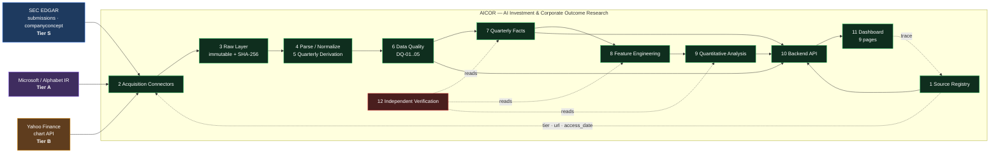
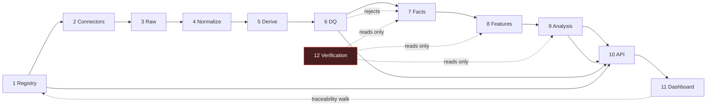

# AICOR — Target System Architecture

**Status:** Proposed · **Date:** 2026-10-13 · **Stack:** ADR-0001 (Python 3.14 / FastAPI / PostgreSQL / Next.js)
**Principle honoured:** no framework migration risk exists because there is nothing to migrate. The architecture is built around the SRS's own provenance chain, not around a preferred tool.

---

## 1. Architectural invariants

These are the load-bearing rules. Every one is mechanically testable, and several correspond to an explicit SRS clause.

| # | Invariant | Enforced by | SRS |
|---|---|---|---|
| **I-1** | The frontend **never** computes a financial or analytical figure | ESLint rule banning arithmetic on API data; `DSH_T01` review gate | DSH-01 |
| **I-2** | Raw snapshots are **immutable and content-addressed**; the pipeline never re-fetches and never overwrites | Write-once store; SHA-256 manifest; `write_raw()` refuses existing hash | MKT-03, NFR-01 |
| **I-3** | Every stored value carries `value / status / reason / source_id / calculation_method / config_version` — NULL is a first-class state | Non-null + check constraints | SRC-05, PRV-01, NFR-03 |
| **I-4** | Every XBRL fact is attributed to a real filing accession, discovered from the SEC `submissions` API — never a hard-coded accession | Foreign key to `filing`; test asserts no orphan | SRC-07 |
| **I-5** | Cross-company joins key on `period_end_date`; `fiscal_period` is display-only | Primary key design; `DAT_T01` | DAT-01 |
| **I-6** | No research parameter is a code literal — all live in versioned config with a `config_version` | No magic numbers in analysis code; lint rule | NFR-03 |
| **I-7** | Secrets never reach the frontend or the database | Settings module; `.env` gitignored; no key in any API response | security |

## 2. Logical layers

The SRS §8 diagram names nine blocks. The implementation refines it to twelve so that *verification* and *provenance* become explicit layers rather than cross-cutting intentions.

| # | Layer | Responsibility | Key artefacts |
|---|---|---|---|
| 1 | **Source registry** | Canonical definition of every source: tier, URL, period, access date, verification status | `source_registry`, `filing`, `config/research_params.yaml` |
| 2 | **Acquisition connectors** | Fetch from SEC (`submissions`, `companyconcept`), company IR, Yahoo. Rate-limited, retried, UA-identified. No parsing. | `ingest/connectors/*` |
| 3 | **Raw data layer** | Immutable, content-addressed snapshots + SHA-256 manifest. The reproducibility substrate. | `data/raw/`, `raw_manifest` |
| 4 | **Parsing & normalization** | XBRL tag resolution (period-aware), sign normalization, duration classification (3M/6M/9M/FY) | `ingest/normalize/*` |
| 5 | **Quarterly derivation** | Cumulative → standalone quarter (Q4 = FY − 9M), with cross-check | `ingest/derive/*` |
| 6 | **Data quality** | DQ-01…DQ-05: completeness, validity, period basis, `A = L + E`, SEC-vs-IR reconciliation | `quality/checks/*` → `data_quality_log` |
| 7 | **Quarterly facts** | `financial_quarterly`, `segments_quarterly`, `market_daily`, `ai_events` | Postgres |
| 8 | **Feature engineering** | FE-01…FE-08, OUT-01…03 with `definition` + `calculation_method` | `features/` → `features_quarterly` |
| 9 | **Quantitative analysis** | LAG, IO, EFF, EVT, REG, SEN, ROB, SCN, RSK | `analysis/` → `analysis_results`, `scenario_results` |
| 10 | **Backend API** | Read-only over layers 7–9. Serves provenance with every payload. | `api/` + `openapi.yaml` |
| 11 | **Dashboard** | 9 pages. Renders stored results. No computation. | `web/` (Next.js) |
| 12 | **Independent verification** | Reconciliation reports, traceability audit, regression ledger — reads everything, writes nothing upstream | `tests/audit/*` |

Layer 12 is deliberately **read-only over the database and write-capable only in its own report namespace**, so QA cannot silently repair data it is auditing.

## 3. System context



## 4. Data flow — SEC XBRL path (the critical path)

```mermaid
flowchart TB
    START(["SEC submissions API"]) --> DISC["Discover filings<br/>form ∈ 10-Q,10-K<br/>→ accession, period, filed"]
    DISC --> PICK["Select filings covering<br/>the 21 calendar quarters"]
    PICK --> CC["Fetch companyconcept<br/>per (company, tag)"]
    CC --> TAG{"Resolve tag<br/>for THIS period"}
    TAG -->|found| DUR["Classify duration<br/>3M · 6M · 9M · FY"]
    TAG -->|"none for a required quarter"| ERR["FAIL LOUDLY<br/>→ data_quality_log severity=ERROR"]
    DUR --> INST{"Instant or<br/>duration?"}
    INST -->|instant| BAL["Balance-sheet instants<br/>Assets/Liab/Equity/Shares"]
    INST -->|duration| SIGN["Sign normalization<br/>CapEx → positive"]
    SIGN --> DERIV{"Fiscal quarter?"}
    DERIV -->|"Q1 (3M)"| Q1["Quarter value = 3M fact"]
    DERIV -->|"Q2 (6M)"| Q2["6M − 3M"]
    DERIV -->|"Q3 (9M)"| Q3["9M − 6M"]
    DERIV -->|"Q4 (FY)""| Q4["FY − 9M  ← no 10-Q exists"]
    Q1 --> XCHK
    Q2 --> XCHK
    Q3 --> XCHK
    Q4 --> XCHK
    XCHK{"Direct 3M fact<br/>also present?"}
    XCHK -->|yes| CMP["Cross-check<br/>must agree within tolerance"]
    XCHK -->|no| PASS
    CMP -->|agree| PASS["quarterly_financials"]
    CMP -->|disagree| DQERR["→ data_quality_log<br/>severity=ERROR"]
    BAL --> DQCHK["DQ-02 validity<br/>DQ-04 A = L + E"]
    PASS --> DQCHK
    DQCHK --> FEAT["8 Feature Engineering"]
    FEAT --> ANA["9 Analysis"]

    classDef bad fill:#7f1d1d,stroke:#ef4444,color:#fff
    classDef good fill:#14532d,stroke:#22c55e,color:#fff
    class ERR,DQERR bad
    class PASS,FEAT,ANA good
```

**The two failure modes this diagram exists to prevent** (both verified real in Phase 1):

- **Silent truncation.** Alphabet's ASC 606 revenue tag stops at 2025-03-31 while `Revenues` continues to 2026-06-30. Resolving a tag per company rather than per company *and period* loses five quarters with no error. Hence `TAG` is inside the per-period loop and `ERR` is a hard stop, never a skip.
- **Q4 phantom.** No 10-Q exists for Q4, so no 3-month cash-flow fact exists for any company. Q4 exists *only* as `FY − 9M`. Anything reading "the 3-month fact" for Q4 silently gets NULL or, worse, the annual figure.

## 5. Repository layout

```
7_AICOR/
├── SPEC.md                          # SRS — requirements baseline (unmodified)
├── .gitignore                       # harness + build + raw-documents ignored
├── docs/
│   ├── adr/                         # architecture decision records
│   │   ├── 0001-technology-stack.md
│   │   ├── 0002-version-control-for-provenance.md
│   │   ├── 0003-api-first-sec-ingestion.md
│   │   ├── 0004-period-aware-tag-resolution.md
│   │   ├── 0005-cumulative-to-quarterly-derivation.md
│   │   └── 0006-research-parameters-are-config-not-code.md
│   └── planning/                    # the 11 planning documents
├── pyproject.toml                   # uv-managed Python project
├── docker-compose.yml               # postgres (dev/test)
├── .env.example                     # names only — no values
├── config/
│   └── research_params.yaml         # ALL research parameters (I-6)
├── migrations/                      # forward-only SQL migrations
├── aicor/
│   ├── settings.py                  # config + secrets (I-7)
│   ├── db/                          # session, models, repositories
│   ├── ingest/
│   │   ├── connectors/              # sec.py · ir.py · market.py
│   │   ├── normalize/               # tag resolution, sign, duration
│   │   └── derive/                  # cumulative → quarterly
│   ├── quality/                     # DQ-01..DQ-05 checks
│   ├── features/                    # FE-01..08, OUT-01..03
│   ├── analysis/                    # lag, io, efficiency, event, regime,
│   │                                #   sensitivity, robustness, scenario
│   ├── api/                         # FastAPI routers, schemas, deps
│   ├── cli.py                       # pipeline entrypoints
│   └── raw/                         # content-addressed store + manifest
├── tests/
│   ├── unit/ integration/ contract/ e2e/
│   └── audit/                       # layer 12 — reconciliation reports
├── data/
│   ├── raw/sec_documents/           # gitignored; hashes in manifest
│   └── raw/market/                  # committed CSVs (small, MKT-03)
└── web/                             # Next.js — renders only (I-1)
```

## 6. Module ownership (one owner per module)

| Path | Owner | Consumed by |
|---|---|---|
| `aicor/ingest/`, `aicor/raw/` | Agent 1 | Agents 2, 3 |
| `aicor/quality/` | Agent 1 | Agent 5 |
| `aicor/features/`, `aicor/analysis/` | Agent 2 | Agent 3 |
| `config/research_params.yaml` | **Agent 2 writes, Agent 0 approves** | Agents 1, 2 |
| `aicor/db/`, `migrations/`, `aicor/api/` | Agent 3 | Agent 4, Agent 5 |
| `docs/openapi.yaml` | **Agent 3 owns, Agent 4 consumes** | Agent 5 |
| `web/` | Agent 4 | Agent 5 |
| `tests/` | Agent 5 | all |
| `docs/adr/`, `docs/planning/` | Agent 0 | all |

**Known shared-file conflict and its resolution:** `research_params.yaml` is written by Agent 2 but is an approved research artefact. Resolution: Agent 2 may add a parameter only as `pending_approval: true`; Agent 0 promotes it. This prevents a blocked research decision from being quietly resolved in code.

## 7. Key API contracts

Full detail in `api_contracts.md`. The three load-bearing ones:

| Endpoint | Purpose | Invariant |
|---|---|---|
| `GET /api/v1/companies/{id}/features` | Feature series for a company | Every row carries `source_id`, `definition`, `status`, `reason` |
| `GET /api/v1/analysis/{type}` | Stored analysis results | Requires `config_version`; never computed on read |
| `GET /api/v1/provenance/{source_id}` | Walk `source_id` → `source_url` → tier → verification | Backs NFR-02 and dashboard page 09 |

**Invariant I-1 restated as an API property:** the API returns *stored* values only. It performs no aggregation, no ratio, no growth rate. Every such computation happened in layer 8 or 9 and is persisted first. This makes DSH-01 structurally true rather than a review convention.

## 8. Error handling, retries, logging

| Concern | Policy |
|---|---|
| SEC rate limit | ≤10 req/s, mandatory `User-Agent` identifying the project, token-bucket limiter, exponential backoff with jitter on 429/5xx |
| Connector failure | Never fabricate. A failed fetch yields `status='unavailable'` + `reason` (SRC-05), logged, and the pipeline continues |
| Tag resolution failure | **Hard error, not a skip** — a missing tag for a required quarter is the silent-truncation guard (OD-08) |
| Derivation mismatch | Logged to `data_quality_log` at severity `ERROR`; the row is kept but flagged, never silently accepted |
| API errors | Uniform JSON error envelope `{error: {code, message, trace_id}}`; 404 vs 422 vs 500 distinguished |
| Logging | Structured JSON; `trace_id` propagated raw-store → normalize → features → analysis → API. **No secrets or API keys in any log line** |
| Partial pipeline runs | Every stage is idempotent and re-runnable against a stored raw snapshot; `run_id` + `config_version` recorded on all writes |

## 9. Configuration & secrets

| Item | Location | Rule |
|---|---|---|
| Research parameters (weights, thresholds, normalisation, windows, shocks) | `config/research_params.yaml` | Versioned, `pending_approval` gate (I-6) |
| DB connection | `.env` (gitignored) → `settings.py` | Never in the frontend bundle (I-7) |
| SEC User-Agent | `.env` | Must identify project + contact; SEC requires this |
| No authentication required | — | AICOR serves public filings only; no auth layer in scope. Note explicitly as an accepted NFR gap (OD-06) |

## 10. Reproducibility strategy (NFR-01)

Reproducibility is engineered, not hoped for:

1. **Pinned dependencies** — `uv.lock` committed; Python 3.14 recorded.
2. **Immutable raw layer** — `raw_manifest` maps every input to a SHA-256; re-runs read snapshots, never the network (MKT-03).
3. **Discovered, not hard-coded, sources** — accessions come from the SEC `submissions` API and are frozen into the manifest at run time, so a re-run cannot silently observe a different filing.
4. **`config_version` on every result row** — NFR-03.
5. **Deterministic analysis** — any stochastic step (bootstrap CIs per OD-05) takes a seed from `research_params.yaml`, stored in `analysis_results.method`.
6. **Verification** — `NFR_T01` runs the pipeline twice into separate schemas and byte-compares `analysis_results`.

## 11. Testing strategy

Full plan in `test_and_acceptance_plan.md`. Architecture-level summary:

| Level | Scope | Owner |
|---|---|---|
| Unit | Tag resolution, YTD→quarterly algebra, formula correctness, NULL guards | Agents 1–2 write, Agent 5 audits |
| Integration | Connector ↔ raw store ↔ DB; cross-check derivation | Agent 1 |
| Contract | OpenAPI consumer/provider verification for `web/` | Agents 3 + 5 |
| Data quality | DQ-01…DQ-05 as executable assertions over real data | Agent 5 |
| E2E | Playwright over the 9 pages, incl. NULL and error states | Agent 5 |
| Audit (L12) | Traceability walk per §9.3; reproducibility re-run | Agent 5 |

**Testing philosophy:** every DQ rule and every formula is a test over **real SEC data**. Mock data is prohibited for acceptance paths (SRC-07), so the test suite doubles as a data-quality monitor.

## 12. Dependencies between layers



Layer 12 has **no inbound write edges** — it cannot alter data it verifies. Layer 6 can *reject* into layer 7, which is the only backward edge in the system and exists to keep bad data out.

## 13. Migration risk

**There is none to manage.** The greenfield state means no framework migration, no directory rename, no large file relocation, and no working feature to preserve. The only migrations that will exist are forward-only SQL schema migrations from here forward, which `database-migrations` governs (expand-contract, reversible, no destructive change without a documented plan).